

# ED Copilot

**English** · [Русский](README.ru.md)

A desktop companion for Elite Dangerous: trading, mining, exobiology, fleet carriers and colonisation. Plan your next task, compare opportunities and keep useful guidance visible while you play.

**[Download for Windows](https://github.com/Naenier/ED-Copilot/releases/latest)** · [User guide (RU)](docs/USER-GUIDE.md) · [Installation and updates (RU)](docs/INSTALLATION.md)

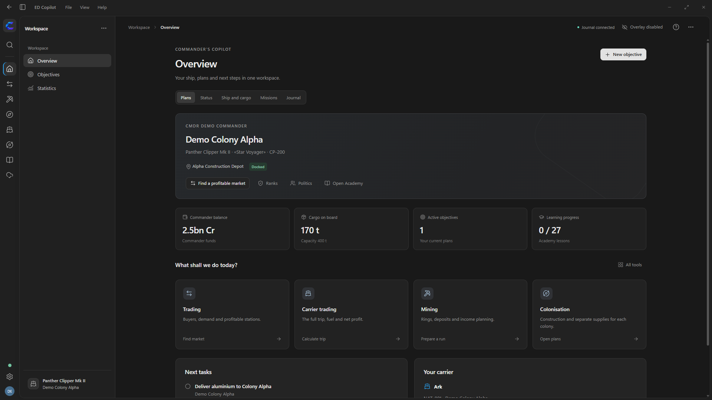

*All screenshots in this README use a demonstration profile with fictional data. Balances and market quotes illustrate the interface.*

## Getting started

1. Install the **Windows Setup** from the latest release, or extract the portable archive and run `ED Copilot.exe`.
2. Start Elite Dangerous. Copilot reads the game journals; choose their folder in Settings if it is not detected automatically.
3. Choose a workspace using the icons on the far left, then open a tool from that workspace’s sidebar. Use **…** to customise the visible tools.
4. Select an activity for the overlay and start working through your plan.

Windows 10/11 x64 is supported. The application window requires Microsoft Edge WebView2 Runtime; the installer offers to install it if needed. You do not need Go, Python or Node.js. You can choose the installation folder, including `C:\Games\ED Copilot`.

## Workspaces and your commander

The slim left rail groups tools into Work, Trading, Industry and development, Exploration, Fleet carriers, Galaxy, Library and Connections. The sidebar shows the selected group. Collapse it when you need more space; the group icons remain available. **Settings** has one permanent button at the bottom of the rail. **Ctrl+K** finds a tool across all groups.

Your avatar opens **Commander**: summary, ranks, finances, inventory, property, fleet, statistics, reputation and journal. Review the current ship alongside observed stored ships, modules, cargo, engineering materials, ship locker and backpack. Each inventory distinguishes an unknown stock from a confirmed empty one.

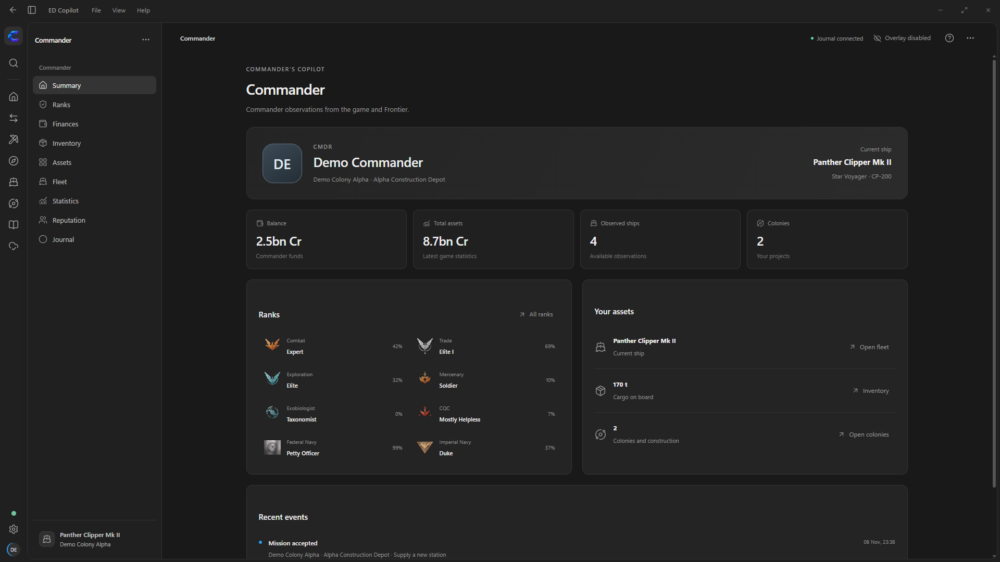

## Star system search

Spansh suggestions are available in star system fields throughout the application. Type three characters, then select a name with the mouse or ↑/↓ and Enter. In multiline route stops, selecting a suggestion replaces only the current line. Results are limited to twenty suggestions, with no local galaxy database required. You can always enter a name manually.

## Exobiology

Choose planets by their biological signals, environmental conditions and the value of potential species. Track three genetic samples, the required separation and your distance from recorded points when live coordinates are available. A dedicated overlay activity supports surface exploration, while sample and sales screens distinguish data on board from confirmed Vista Genomics sales.

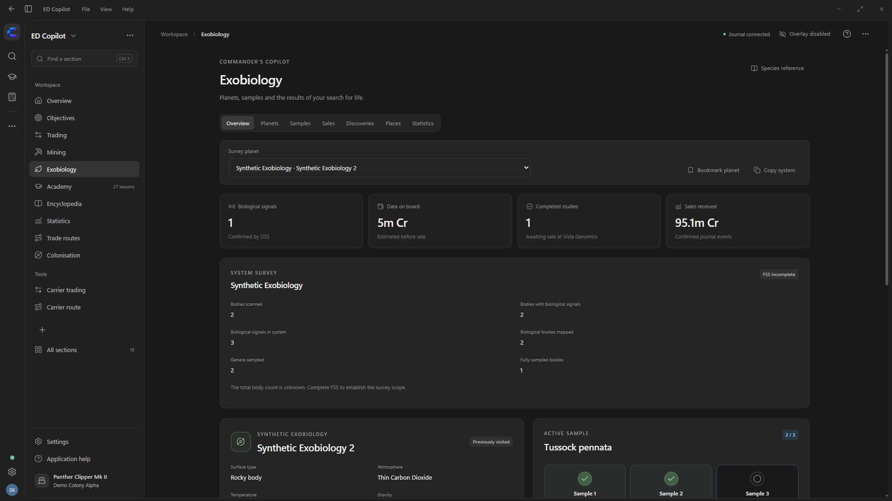

The reference catalogue includes 126 species across 25 genera, habitat conditions, variants and 101 photographs. Planet bookmarks, surface waypoints, a public observation index and expedition statistics help organise your research. First footfall status, estimated payouts and unknown coordinates are identified separately. [Exobiology guide (RU)](docs/EXOBIOLOGY.md).

## Trading and mining

Find stations and fleet carriers where you can buy or sell a commodity. Compare price per tonne, demand, supply, landing pad size, distance and the age of each observation. Search for trade routes that fit your cargo hold and budget, keep a destination in the overlay and track your transactions.

Mining tools help you find valuable rings and planets, filter suitable targets, inspect prospected asteroids, check equipment and review mining sessions. Engineering materials and commodities for sale are tracked separately.

## Trade routes: from search to a usable plan

The route screen presents both stations on a wide card, including their systems, landing pads, arrival distances, buy and sell prices, supply, demand and observation times. A return load on an A → B → A route has its own commodity and calculation. Copy each system or station name independently, then paste it into the game.

Search takes available cargo space, your known credit balance, market volume, costs and personal limits into account. Profit per hour uses the leg duration you enter; travel to the first station is excluded. Unknown cargo capacity and budgets are requested explicitly, while a known zero remains zero.

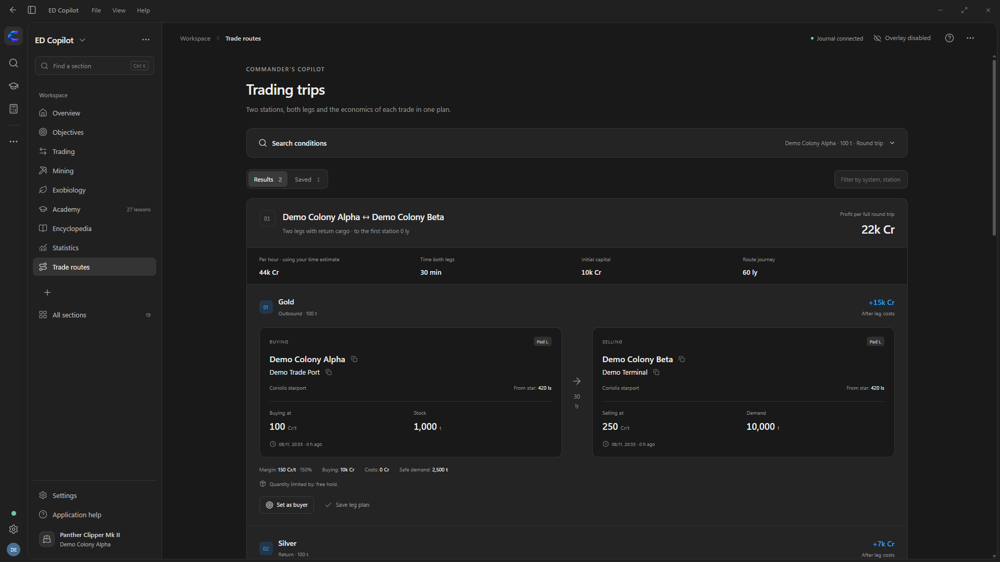

Select a route, set its buyer as the overlay destination or save a plan for a particular leg. Keep up to 40 complete routes, including both market quotes, in Saved. These are observation snapshots: run a new search before repeating a route to check current prices and available volume.

## Fleet carrier trading: the whole journey in one calculation

Find fully loaded runs with at least 400 million credits in estimated net profit. Copilot compares fresh regional markets and Rackham’s Peak, and can combine purchases across stations and systems. Each result includes separate estimates for jumping, loading, unloading and preparing tritium.

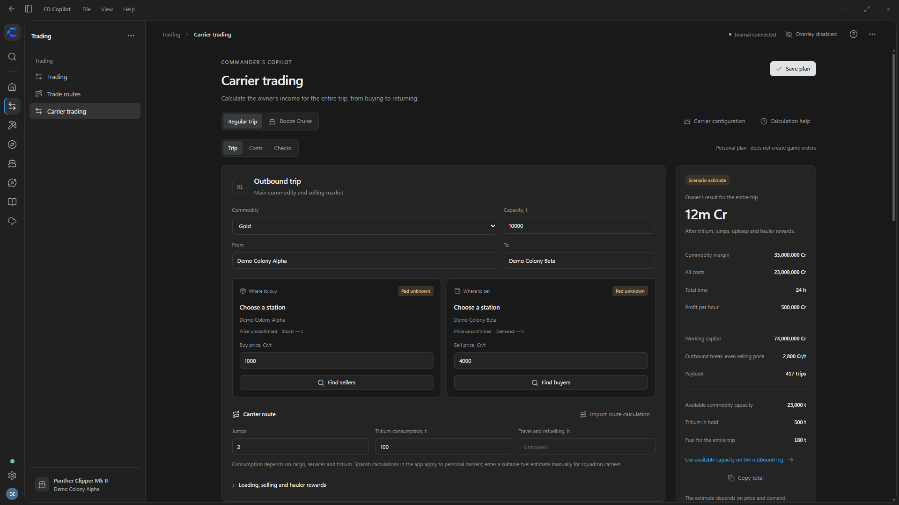

Rackham’s Peak has a medium landing pad. The calculation uses a fresh market quote or a price you enter; confirm Public Holiday in the game.

A separate calculator compares the purchase and running costs of personal and squadron fleet carriers.

## Personal fleet carrier routes

Calculate jumps, fuel consumption, refuelling, the reserve on arrival and journey time. When your fuel stock is known, the form starts with that amount. Minimum starting fuel is a separate option for planning the required stock. Fuel cost remains unknown until you provide a tritium price.

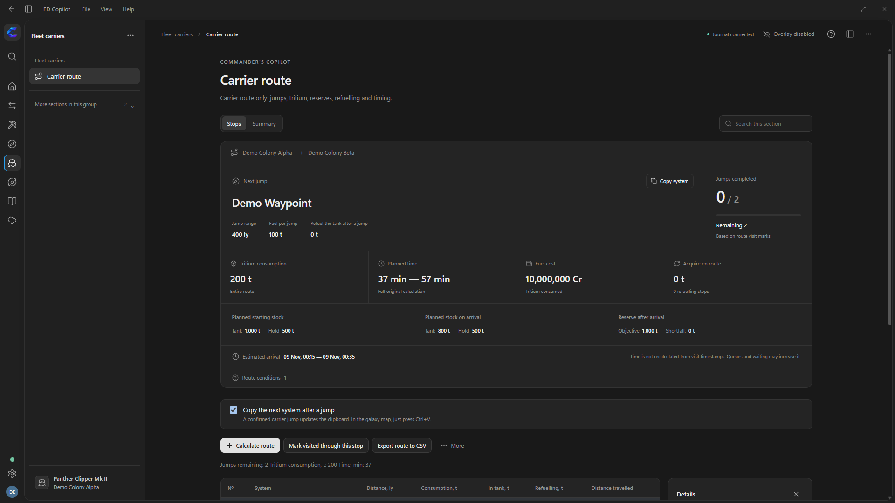

After a confirmed arrival, the next system can be copied to the clipboard automatically: press **Ctrl+V** in the galaxy map to paste it. Schedule jumps in the game.

## A reference library with complete entity pages

Browse by category, search by name and narrow results by group. Ships and engineers have illustrated catalogue cards; each entry opens a full page with properties, requirements and related entries.

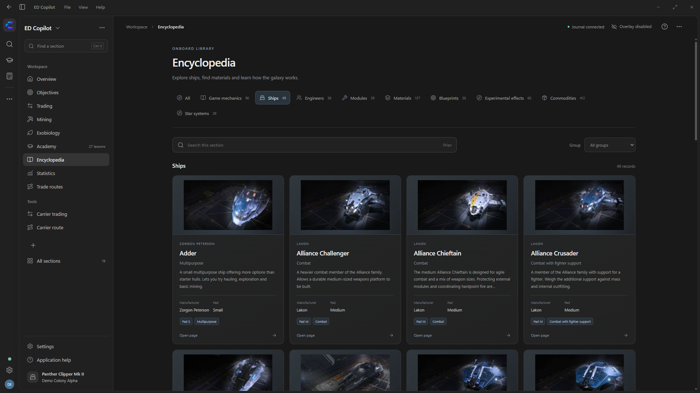

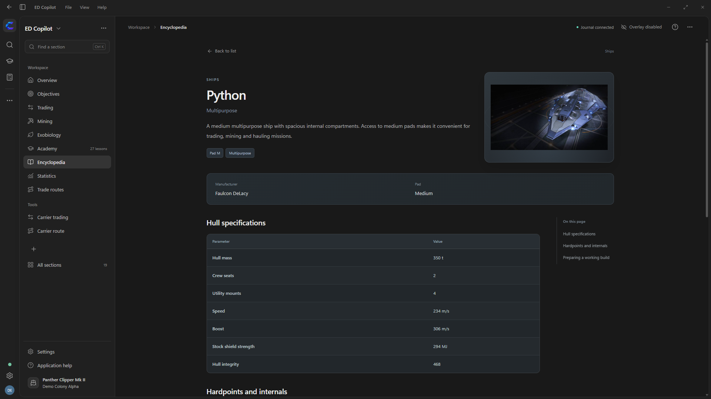

Engineers are also accessible from engineering plans. Their pages show introduction requirements and supported upgrades. Material pages include your known inventory, while blueprint families bring together grade recipes and experimental effects.

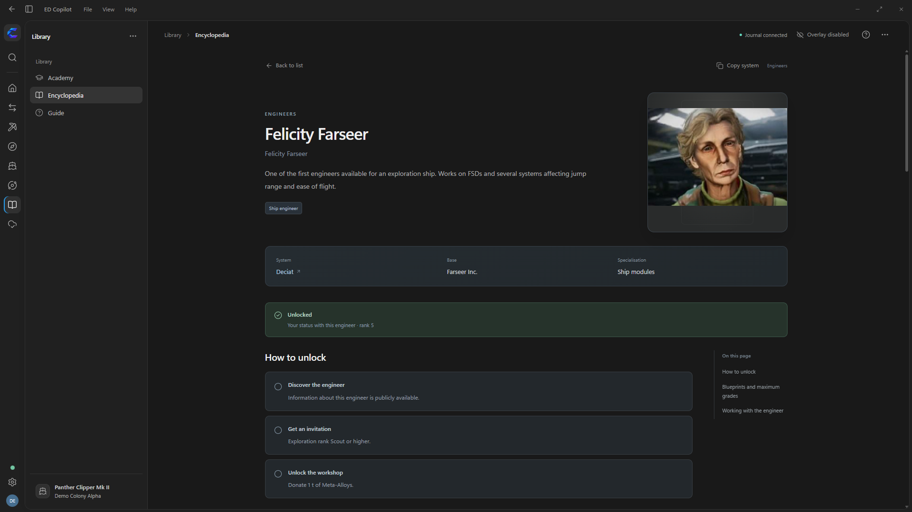

Read articles in a spacious layout with a table of contents. Commodity pages offer buy and sell views, show market offers and open trading with the commodity already selected.

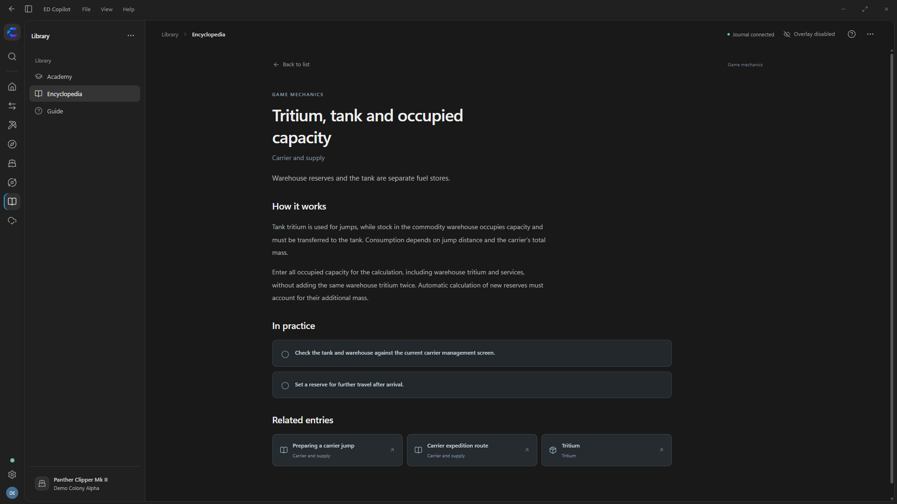

## Colonies, engineering and personal plans

Manage multiple colonies independently. Choose a system using your preferred starting faction, plan the construction order and supply queue, then compare bills of materials with accepted deliveries. The overlay shows the next task for the selected colony.

Start with an origin system and its stations, then select the station and controlling faction. Candidate systems show population, permit requirements, known signs of settlement and colonisation, permanent station counts and observation dates.

Carrier stock is optional. Enable **Use fleet carrier stock** to include known personal-carrier cargo; enable **Squadron cargo is available** as well when you can use that stock. These settings are shared, while supply requirements and queues belong to each colony. The selected plan shows the sources separately with their callsigns and observation times. After sign-in, Frontier observations refresh automatically in the background. Stock aboard a carrier remains separate from cargo on your ship and accepted construction deliveries; it is not reserved between colony plans.

The **Budget** view values every commodity at its latest observed galactic average price, with full, remaining and procurement totals for all planned and active construction in the selected colony. Missing bills and prices remain explicit. The overlay stays focused on logistics: up to ten outstanding commodities, excluding requirements already covered by fresh accessible carrier stock when carrier accounting is enabled. Fully covered commodities remain visible in the application.

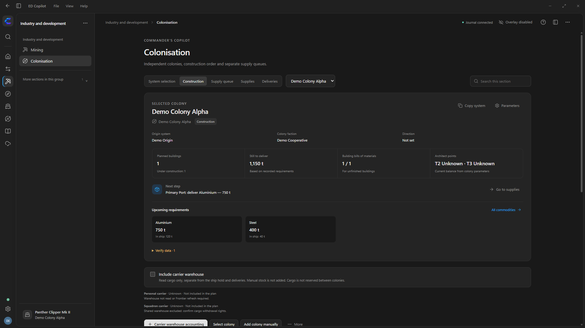

Engineering plans combine material requirements for multiple modules and upgrades. Compare requirements with your inventory, work out material trades and save your list. Overview, objectives, missions and statistics keep current tasks together.

## Commander ranks and galactic politics

Track all eight in-game rank disciplines with individual progress bars. Open a rank for advancement methods and a ladder of practical unlocks, including rank-gated ships, permits and discounts. Journal observations and promotions are dated separately; unknown progress remains unknown.

Career cards use the emblem for your observed rank, while naval cards use their faction’s crest. Unknown ranks have a neutral symbol.

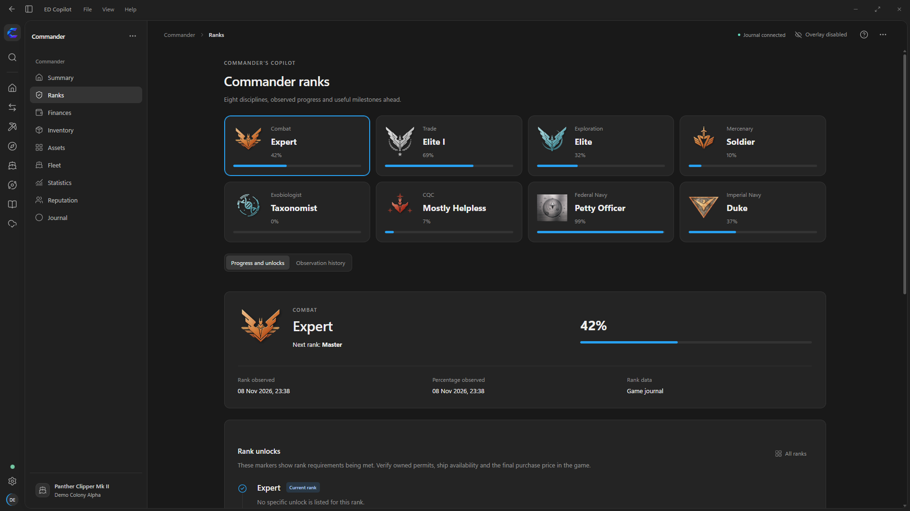

Politics brings together public community goals, your recorded contribution, Powerplay powers and indexed systems, local faction influence and conflicts, and reported Thargoid states. Search a system or filter political observations, inspect timestamps and copy a destination into the galaxy map. Cached observations remain available offline.

## Academy

Nine courses and 27 lessons cover trading, group operations, getting started with Odyssey, fleet carriers and passenger runs. Follow practical Copilot workflows, worked fictional examples, decision checklists and recovery steps. All lessons are available in English and Russian, with saved answers, favourites and reading positions.

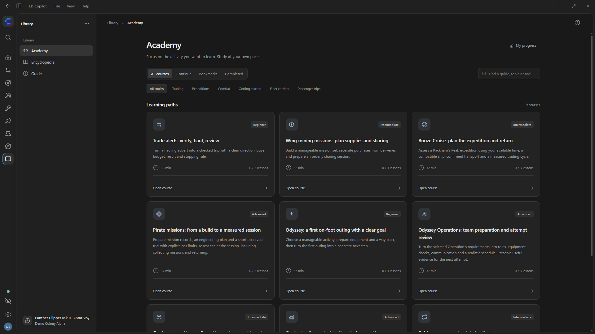

## In-game guidance and controls

The overlay displays panels for the selected activity only while Elite Dangerous is focused. It adapts to ship, SRV/Nomad and on-foot play; switching to Copilot hides the game panels.

Compact panels fill the right side first, then continue on the left. In a ship or SRV, they stay above the lower cockpit instruments. The overlay starts with useful task information, without a permanent product or activity header. Location appears briefly within a relevant panel when needed. Empty plans and repeated information are hidden; an idle activity leaves the game clear. Your colonies are recovered from journal claims and become available in the overlay selector.

| Shortcut | Action |
| --- | --- |
| **Ctrl+K** | Jump to a section, including with a Russian keyboard layout. |
| **F11** | Enter or leave full screen. |
| **Ctrl+Alt+H** | Toggle the overlay. |

Customise the section order, window mode and colours. Import the overlay palette from the game and preview it before applying.

## Interface language

The application starts in **English** on first launch. Choose English or Russian in Settings; your choice is retained between sessions. System names, station names and personal notes are preserved. Academy lessons are available in both languages.

This README is also available [in Russian](README.ru.md).

## Connections and updates

Sign in with Frontier once to retrieve supported account information and keep it refreshed automatically in the background. To send supported events to Inara, add your personal API key and enable sending in Synchronization.

Automatic updates are enabled by default and can be switched off in Settings. Stable GitHub releases download quietly and are checked against published SHA256 digests. Installation waits until you fully exit Copilot; the next launch shows the changes. Setup provides separate Start Menu and desktop shortcut choices and preserves them during updates.

Plans, settings and progress are stored in `%LOCALAPPDATA%\ED Copilot`, separately from the application. Before updating, fully exit through the File menu or the system tray icon. The installer preserves your personal profile.

Embedded reference data, the Academy and local plans work offline. New market searches, system suggestions, route planning and synchronisation require an internet connection. A dash means a value is unknown; check quote timestamps before travelling. Purchases, orders, construction and jump scheduling take place in the game.

[Full user guide (RU)](docs/USER-GUIDE.md) · [Installation (RU)](docs/INSTALLATION.md) · [What's new](docs/RELEASE-2.8.4.md) · [Build and delivery](docs/DELIVERY.md)
