

# ED Copilot

[English](README.md) · **Русский**

Помощник пилота Elite Dangerous. Ищите звёздные системы, планируйте инженерные улучшения и колонизацию, сравнивайте варианты торговли и добычи, прокладывайте маршруты флотоносца и отслеживайте находки экзобиологии.

**[Скачать для Windows](https://github.com/Naenier/ED-Copilot/releases/latest)** · [Руководство](docs/USER-GUIDE.md) · [Установка и обновление](docs/INSTALLATION.md)

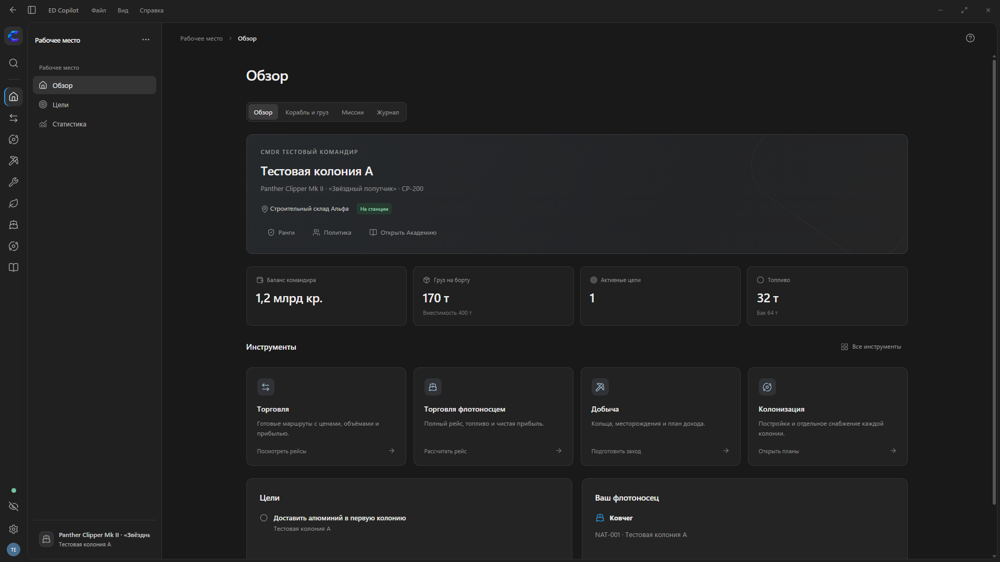

*На снимках показан ED Copilot 2.8.7 в демонстрационном профиле. Данные командира, суммы и котировки вымышлены.*

## Начать пользоваться

1. Установите **Windows Setup** из последнего релиза или распакуйте переносимый архив и запустите `ED Copilot.exe`.
2. Откройте Elite Dangerous. Приложение прочитает игровые журналы; при необходимости выберите их папку в настройках.
3. Выберите группу значком у левого края, затем откройте инструмент в боковом меню. Через **«Вид → Настроить меню»** можно менять видимые разделы в группах «Рабочее место», «Флотоносцы» и «Библиотека».
4. Выберите занятие для оверлея и приступайте к своему плану.

Поддерживаются Windows 10/11 x64. Для окна нужен Microsoft Edge WebView2 Runtime: установщик предложит добавить его, если компонента нет. Go, Python и Node.js пользователю устанавливать не требуется. Папку установки можно выбрать, в том числе `C:\Games\ED Copilot`.

## Рабочие группы и командир

Слева доступны группы «Рабочее место», «Торговля», «Колонизация», «Добыча», «Инженерия», «Экзобиология», «Флотоносцы», «Галактика» и «Библиотека». Боковое меню можно свернуть, сохранив доступ к значкам групп. **«Настройки»** открываются кнопкой внизу. **Ctrl+K** находит инструмент во всех группах.

Нажмите на аватар, чтобы открыть раздел **«Командир»** со сводкой, рангами, финансами, инвентарём, имуществом, флотом, статистикой и журналом. Репутация сверхдержав находится в сводке. Инвентарь отличает неизвестный запас от подтверждённого пустого.

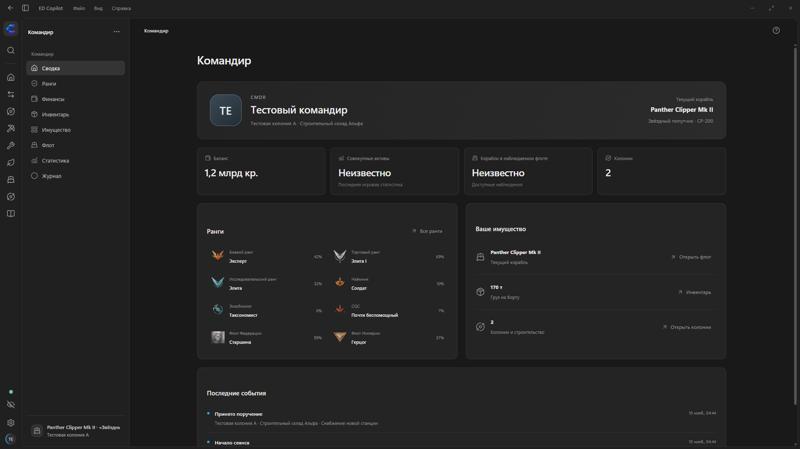

## Поиск звёздных систем

В разделе **«Галактика → Системы»** можно открыть систему по названию или найти системы в радиусе до 100 св. л. от выбранной точки. Для соседних систем доступны фильтры по населению, принадлежности, правительству, экономике и безопасности. Карточки загружают из EDSM координаты, разрешения, небесные тела и их материалы, станции и влияние фракций. При переключении на Spansh в результатах виден источник и отображается до 50 ближайших систем.

В полях звёздных систем доступно до двадцати подсказок от Spansh и EDSM. Введите три символа и выберите название мышью или клавишами ↑/↓ и Enter. В многострочных остановках маршрута заменяется только текущая строка. Название также можно ввести вручную.

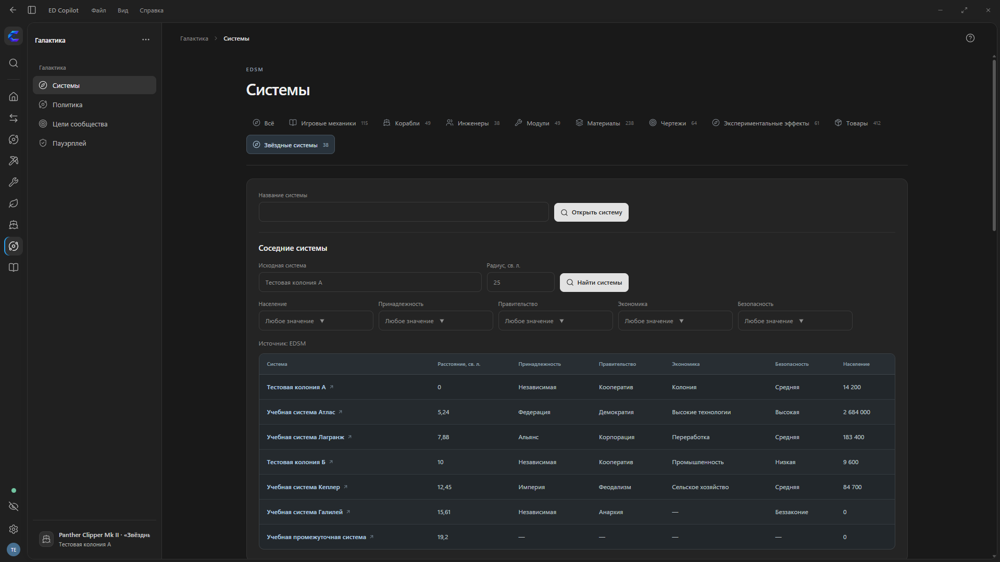

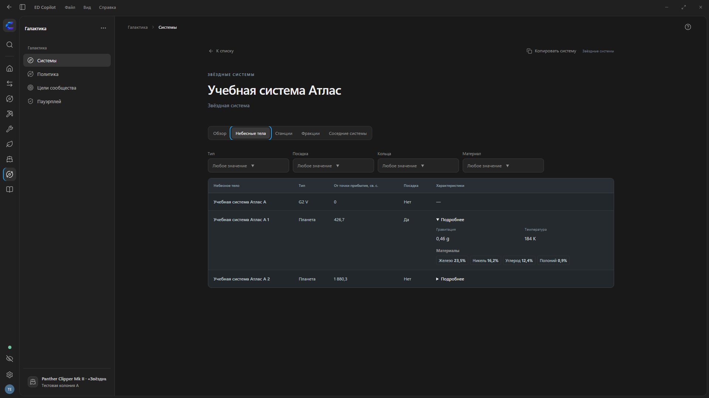

## Экзобиология

Выбирайте планеты по биосигналам, условиям и ценности возможных видов. Следите за тремя генетическими пробами, минимальным разносом и расстоянием до сохранённых точек, когда доступны живые координаты. Отдельный режим оверлея помогает на поверхности, а вкладки образцов и продаж показывают данные до и после Vista Genomics.

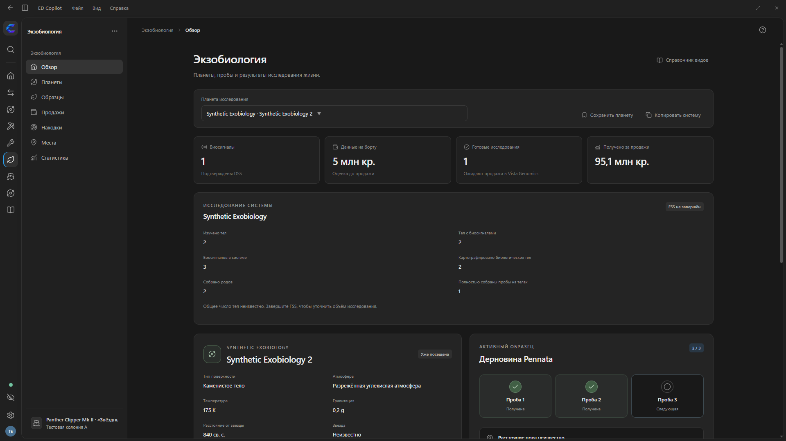

Справочник содержит 126 видов из 25 родов, условия обитания, варианты и 101 фотографию. Доступны закладки планет, точки поверхности, публичный индекс находок и статистика. Первый след, предполагаемая выплата и неизвестные координаты обозначаются отдельно. [Как пользоваться экзобиологией](docs/EXOBIOLOGY.md).

## Торговля и добыча

Ищите станции и флотоносцы для покупки или продажи товара. Сравнивайте цену за тонну, спрос и запас, размер площадки, расстояние и время наблюдения. Подбирайте торговые рейсы под трюм и бюджет, сохраняйте назначение для оверлея и учитывайте сделки.

Для добычи доступны поиск ценных колец и планет, отбор по качеству, анализ астероида, проверка оснащения и статистика заходов. Материалы для инженерии и продаваемые товары учитываются отдельно.

## Торговые рейсы — от поиска до плана

Раздел «Рейсы» показывает обе станции на широкой карточке: систему, площадку, расстояние от звезды, закупочную и продажную цены, запас, спрос и время наблюдения. Обратный груз A → B → A отображается отдельным плечом с собственным товаром и расчётом. Систему и название каждой станции можно копировать независимо, затем вставить в игре.

Поиск учитывает свободный трюм, известный баланс, доступный объём рынка, расходы и ваши ограничения. Прибыль за час основана на введённом времени плеча; дорога до первой станции в него не входит. Неизвестные трюм и бюджет предлагается заполнить, а известный ноль сохраняет своё значение.

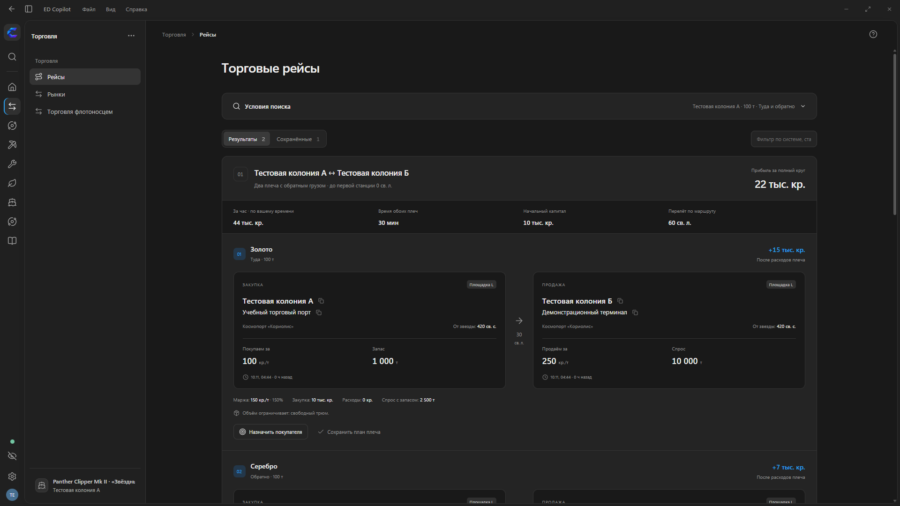

Выберите рейс, назначьте покупателя для оверлея или сохраните план нужного плеча. В «Сохранённых» помещается до 40 полных маршрутов с обеими котировками. Это снимки наблюдений: перед повторным рейсом выполните новый поиск, чтобы проверить цены и доступный объём.

## Торговля флотоносцем — весь рейс в одном расчёте

Ищите рейсы с полным трюмом и расчётной чистой прибылью от 400 млн кредитов. Copilot сравнивает свежие рынки в регионе и Rackham’s Peak, объединяет закупки на нескольких станциях и в разных системах. В каждом варианте отдельно рассчитано время на прыжки, погрузку, разгрузку и подготовку трития.

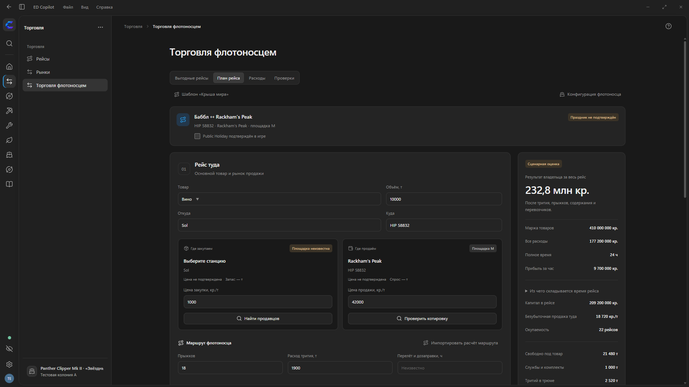

У Rackham’s Peak максимальная площадка **M**. Для расчёта используется свежая котировка или введённая вами цена. Наличие Public Holiday подтверждайте в игре.

Отдельный калькулятор сравнивает покупку и содержание личного и эскадрильного флотоносцев.

## Маршрут личного флотоносца

Рассчитайте прыжки, расход топлива, пополнение, резерв по прибытии и время. При известном запасе форма начинает с него; расчёт минимального стартового топлива выбирается отдельно и описывает планируемый запас. Денежная оценка остаётся неизвестной, пока не задана цена трития.

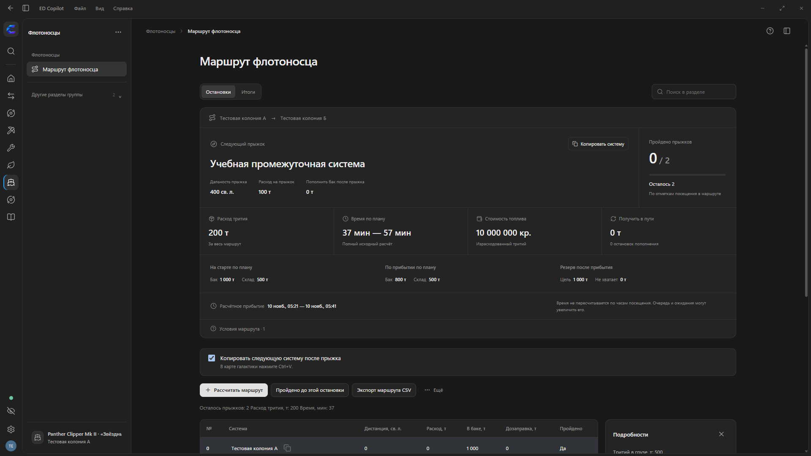

После подтверждённого прибытия следующая система может автоматически копироваться в буфер обмена — в карте галактики останется нажать **Ctrl+V**. Назначение прыжков выполняется в игре.

## Энциклопедия с полноценными страницами

Выбирайте категорию, ищите по названию и фильтруйте по группе. Корабли и инженеры представлены карточками с изображениями; каждая запись открывается на отдельной странице с характеристиками, условиями и связанными материалами.

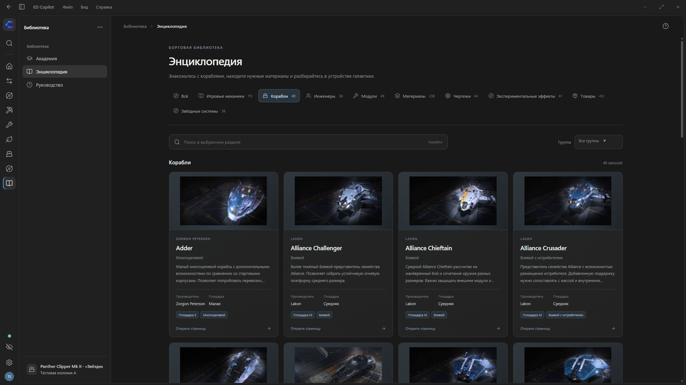

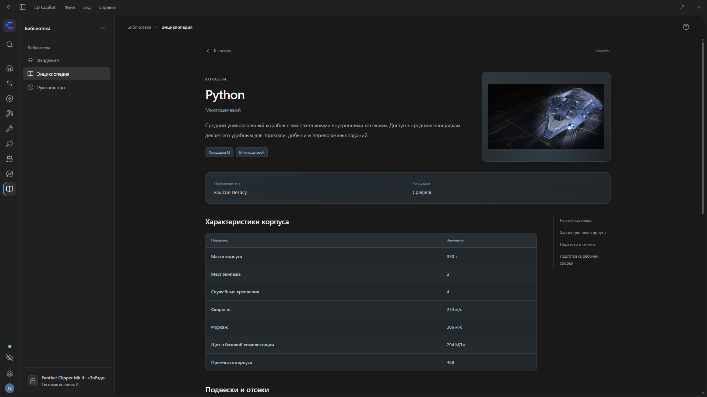

На страницах инженеров собраны условия знакомства и открытия, расположение мастерских и доступные улучшения. Страницы модулей ведут к совместимым чертежам и экспериментальным эффектам. Страницы материалов показывают известный запас, способы добычи, курсы обмена и рецепты.

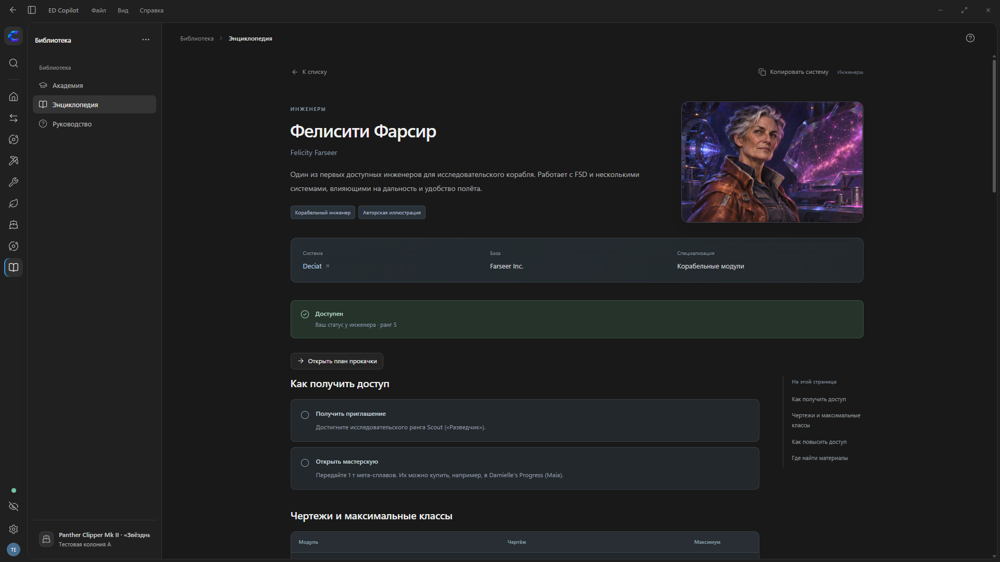

Статьи удобно читать на широком экране с оглавлением. Страница товара позволяет перейти к покупке и продаже, увидеть предложения и открыть торговлю с уже выбранным ресурсом.

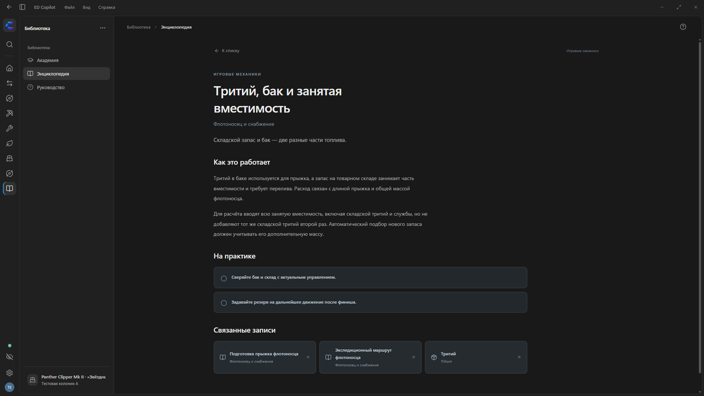

## Колонии

Ведите несколько колоний независимо: выбирайте систему с нужной исходной фракцией, планируйте порядок построек и очередь снабжения, сверяйте сметы и принятые поставки. Оверлей подскажет следующую задачу выбранной колонии.

Подбор начинается с исходной системы и её станций, затем — станции и контролирующей фракции. У кандидатов видны население, требование разрешения, известные признаки заселения и колонизации, число постоянных станций и дата наблюдения.

Учёт запаса флотоносца включается по желанию. Включите **«Учитывать склад флотоносца»**, чтобы использовать известный личный запас, и дополнительно **«Доступен груз эскадры»**, если можете распоряжаться им. Эти настройки общие, а потребности и очереди снабжения принадлежат каждой колонии. Выбранный план показывает источники отдельно, с позывными и временем получения. После входа сведения Frontier обновляются автоматически в фоне. Запас остаётся отдельным от груза корабля и принятых поставок; между планами колоний он не резервируется.

Экран **«Бюджет»** оценивает каждый товар по последней прочитанной среднегалактической цене. Отдельно показаны полная стоимость ресурсов всех запланированных и строящихся объектов выбранной колонии, недоставленный остаток и необходимая закупка. Неизвестные сметы и цены остаются явно обозначенными. В оверлее показывается до десяти нужных позиций; при включённом учёте склада полностью обеспеченные свежим доступным запасом флотоносца товары скрываются, сохраняясь в приложении.

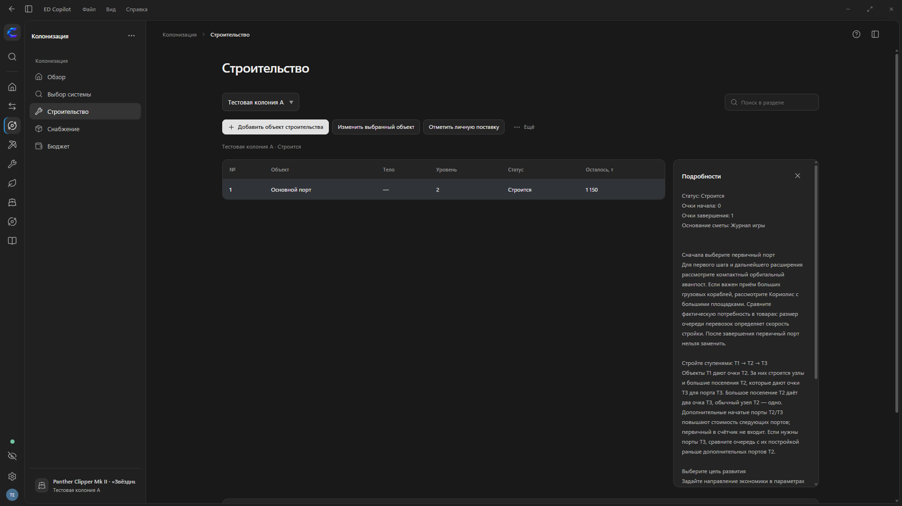

## Инженерия

В разделе **«Инженерия → Прокачка»** можно посмотреть порядок открытия инженеров и отфильтровать их по модулю, чертежу или экспериментальному эффекту. Из требований можно открыть связанные статьи и сверить стоимость рецепта с известным запасом. **«Инженерия → План»** суммирует потребности нескольких улучшений.

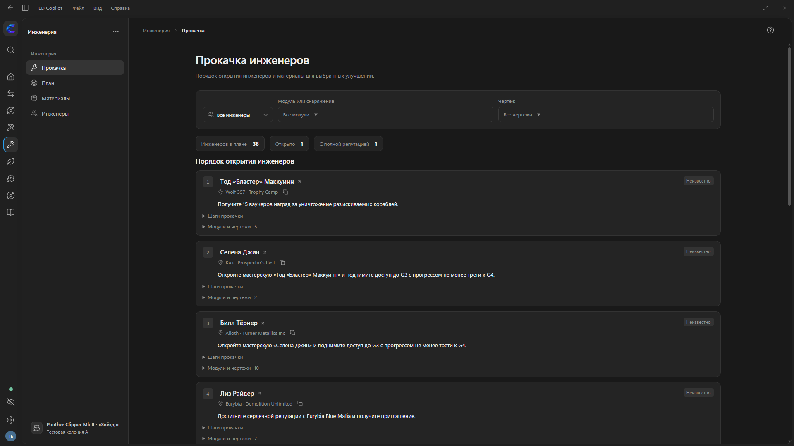

Откройте **«Инженерия → Материалы»**, чтобы проверить запасы, или выберите **«Рассчитать обмен»**. Калькулятор покажет варианты для выбранного материала и отметит те, на которые хватает запаса.

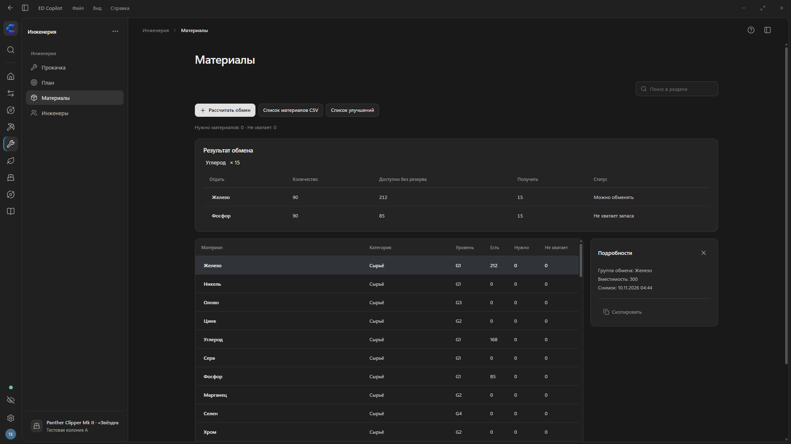

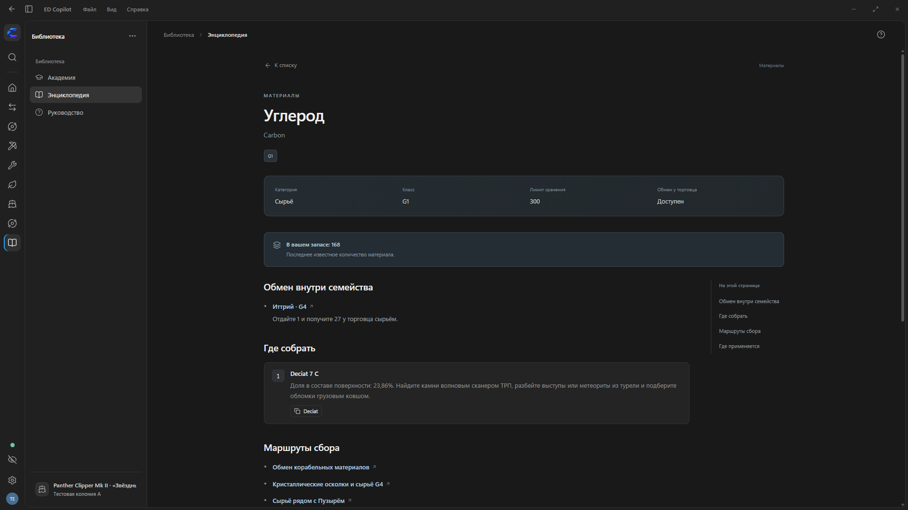

## Ранги командира и политика

Восемь игровых направлений показаны отдельными карточками с прогрессом. Для каждого ранга доступны способы повышения и конкретные награды по ступеням: корабли, разрешения в системы и скидки. Неизвестный процент не подменяется нулём; наблюдение ранга отделено от подтверждённого повышения.

Карточки карьерных направлений показывают эмблему наблюдаемого ранга, а флотские — герб своей сверхдержавы. Неизвестному рангу соответствует нейтральный символ.

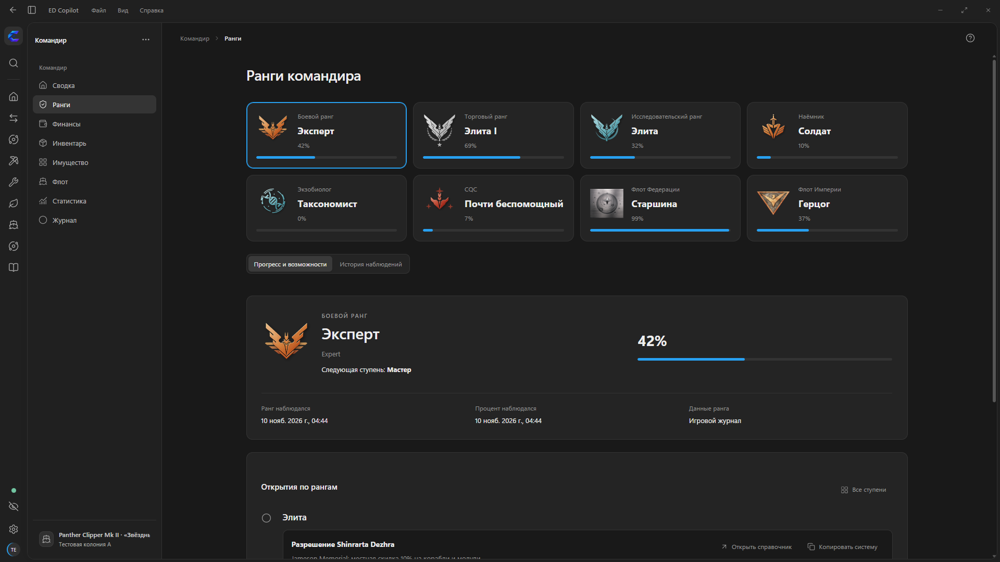

В «Политике» собраны цели сообщества и личный вклад из журнала, державы и системы Powerplay, влияние фракций, локальные конфликты и известные состояния таргоидов. Можно выбрать систему, отфильтровать наблюдения, проверить время данных и скопировать название в карту галактики. Последние сведения сохраняются для чтения без сети.

## Академия

Девять курсов и 27 уроков на русском и английском: торговля, групповые операции, первые шаги Odyssey, флотоносцы и пассажирские рейсы. Практические инструкции для Copilot дополнены учебными расчётами, критериями выбора, разбором ошибок и чек-листами. Избранное, ответы и место чтения сохраняются.

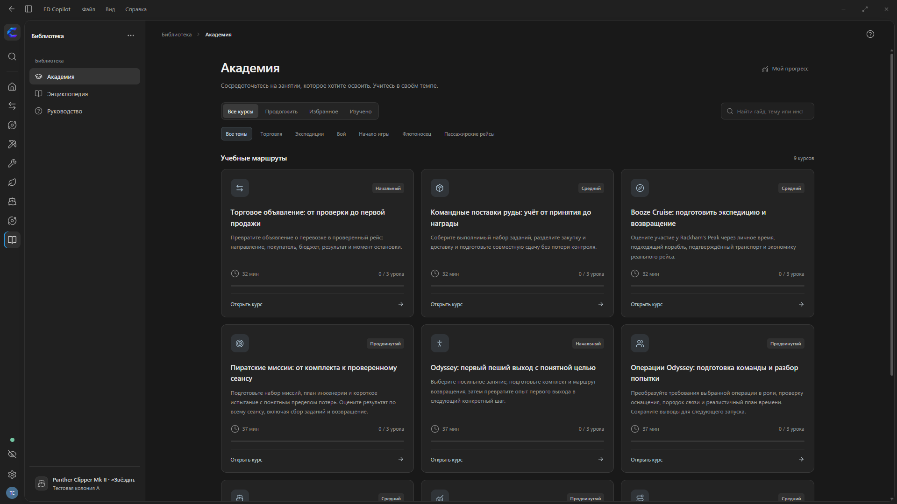

## Подсказки в игре и удобное управление

Оверлей показывает панели выбранного занятия только при активной Elite Dangerous. Он адаптируется к кораблю, ТРП/Nomad и пешему режиму; переключение в Copilot скрывает игровые панели.

Компактные панели сначала заполняют правую сторону, затем переходят влево. В корабле и ТРП они остаются выше нижних приборов. Сразу показана задача: постоянной шапки с названием приложения и занятием нет. Местоположение кратко появляется в подходящей панели, когда оно нужно. Пустые планы и повторы скрыты; при отсутствии задач игра остаётся свободной. Собственные колонии восстанавливаются по заявкам из журналов и появляются в выборе для оверлея.

| Клавиши | Действие |
| --- | --- |
| **Ctrl+K** | Быстрый переход по разделам, в том числе при русской раскладке. |
| **F11** | Полный экран и возврат в окно. |
| **Ctrl+Alt+H** | Включение и выключение оверлея. |

Настраивайте порядок разделов, режим окна и цвета. Палитру оверлея можно скопировать из игры и сначала оценить в предпросмотре.

## Язык интерфейса

При первом запуске используется **английский**. В «Настройках» можно выбрать русский или английский; выбор сохраняется между запусками. Названия систем, станций и личные записи остаются без изменений. Материалы Академии доступны на обоих языках.

Этот README также доступен [на английском](README.md).

## Подключения и обновления

В **«Настройки → Подключения»** войдите во Frontier, чтобы поддерживаемые сведения аккаунта обновлялись в фоне. В блоке **Inara** добавьте личный API-ключ и включите отправку событий.

Автоматические обновления включены по умолчанию и отключаются в настройках. Приложение загружает стабильный релиз GitHub в фоне и проверяет его по SHA256. Установка ждёт полного завершения Copilot, а при следующем запуске показываются изменения. В установщике можно отдельно выбрать ярлыки в меню «Пуск» и на рабочем столе. Выбор сохраняется при обновлении.

Планы, настройки и прогресс находятся в `%LOCALAPPDATA%\ED Copilot`, отдельно от программы. Перед обновлением полностью завершите приложение через меню «Файл» или значок в области уведомлений. Установщик сохраняет личный профиль.

Встроенные справочники, Академия и локальные планы доступны без сети. Для поиска новых рыночных предложений, систем, маршрутов и синхронизации требуется интернет. Прочерк означает неизвестное значение; проверяйте дату котировки перед рейсом. Покупки, заказы, строительство и назначение прыжков выполняются в игре.

[Полное руководство](docs/USER-GUIDE.md) · [Установка](docs/INSTALLATION.md) · [Что нового в 2.8.7](docs/RELEASE-2.8.7.md) · [Сборка и доставка](docs/DELIVERY.md)
